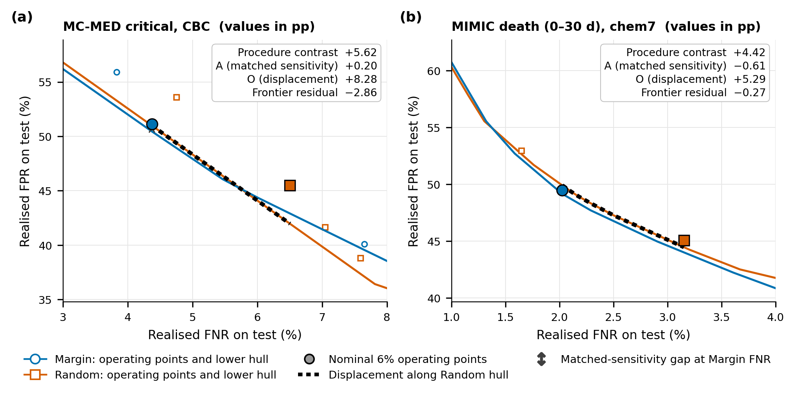

<div align="center">

# Shared Capacity

**Statistical evaluation of capacity-constrained test allocation**

*Operating-point displacement · Threshold-selection variability · Decision-dependent labels*

[Overview](#overview) · [Methods](#what-the-code-does) · [Quick start](#quick-start) · [Reproduction](#reproducing-the-analyses) · [Data](#data-and-access)

</div>

---

## Overview

Electronic health records allow laboratory-allocation policies to be evaluated retrospectively: recorded test results are hidden, then revealed only for encounters selected by each policy. But comparisons at a nominal false-negative-rate target can reflect differences in **realised operating points**, **threshold selection**, and **the outcomes recorded under existing care**.

<div align="center">
  
  <br />
  <sub>Operating-point decomposition for two emergency-department comparisons. See the manuscript for definitions and interpretation.</sub>
</div>

## What the code does

<table>
<tr>
<td width="33%" valign="top">
  <strong>01 / Compare at matched sensitivity</strong><br /><br />
  Construct empirical FNR–FPR frontiers and decompose an observed procedure contrast into a matched-sensitivity component, operating-point displacement and a frontier residual.
</td>
<td width="33%" valign="top">
  <strong>02 / Propagate threshold variability</strong><br /><br />
  Study grid and order-statistic thresholds. Resample calibration and evaluation pools to capture uncertainty from repeated threshold selection.
</td>
<td width="34%" valign="top">
  <strong>03 / Account for decision-dependent labels</strong><br /><br />
  Evaluate the retrospective–deployment gap under cost-weighted classification loss, with allocation-stratified identities, sensitivity analyses and label-flip bounds.
</td>
</tr>
</table>

### Empirical snapshot

In six emergency-department comparisons involving CBC or chemistry panels, operating-point displacement reached **8.3 percentage points**. Three procedure point estimates changed sign at matched sensitivity. None of the six joint-resampling 95% intervals for the procedure contrasts excluded zero.

These are results for the analysed cohorts and policies; the full estimates and uncertainty intervals are reported in the manuscript.

## Repository map

```text
sharedcapacity/
├── src/sharedcap_afa/             # Statistical evaluation and allocation engine
├── simulation/                   # Synthetic DGP and fixed-predictor experiments
├── scripts/
│   ├── patient_level/            # Frontier, threshold, and label-sensitivity analyses
│   ├── tests/                    # Synthetic unit checks
│   ├── audits/                   # Additional simulation diagnostics
│   ├── sharedcap/                # Aggregate-level calculations and figure scripts
│   └── reproduce_aggregates.py  # Rebuild aggregate tables and illustrative plots
├── results/
│   ├── 06_simulation/            # Simulation summaries and run manifest
│   └── 11_patient_level/        # Released aggregate estimates
├── pyproject.toml
└── README.md
```

Additional aggregate input tables in `results/01_primary/`–`results/06_simulation/` support the rebuilding script. The project uses a pool size of 16, with 5 test allocations per pool in its principal experiments.

## Quick start

**Requirements:** Python 3.10 or later.

```bash
git clone https://github.com/Ichbin123/sharedcapacity.git
cd sharedcapacity

python -m venv .venv
source .venv/bin/activate  # Windows: .venv\Scripts\activate
python -m pip install -e .

python scripts/tests/test_patient_level.py
```

The test script checks the evaluation-gap identity, unstructured label-flip bounds, order-statistic thresholds and frontier decomposition on synthetic data.

## Reproducing the analyses

**1 · Run a short synthetic experiment**

```bash
python -m simulation.fixed_predictor \
  --alphas 0 --gammas 0 --reps 1 \
  --out-dir outputs/simulation-smoke-test
```

**2 · Run the manuscript's 3 × 3 synthetic design**

```bash
python -m simulation.fixed_predictor \
  --alphas 0,0.5,1 --gammas 0,0.5,1 \
  --reps 100 --seed 20261118 \
  --out-dir outputs/simulation-main
```

This reproduces the original synthetic experimental design; the archived settings and source checksums are in `results/06_simulation/confirmatory_3x3_100_manifest.json`. Outputs are written to `outputs/` and are not tracked by Git.

**3 · Regenerate aggregate tables and illustrative figures**

```bash
python scripts/reproduce_aggregates.py
```

The script reads the released summary-level inputs, writes derived CSV files under `results/10_refactor_derived/` and generates plots under `figures/`. The source figures embedded above reflect the final manuscript layout; regenerated plots may differ in formatting.

**4 · Re-evaluate restricted clinical data in an authorised environment**

```bash
python scripts/patient_level/export_schema.py --validate /secure/path/to/exports

python scripts/patient_level/run_patient_level.py \
  --input-dir /secure/path/to/exports \
  --out /secure/path/to/derived-results
```

The patient-level tools require appropriately prepared, credentialed EHR exports. An export template is available at `scripts/patient_level/export_mapping_TEMPLATE.json`. See [Reproducibility notes](docs/REPRODUCIBILITY.md) for the workflow and output definitions.

## Data and access

The empirical application uses **MIMIC-IV**, **MIMIC-IV-ED** and **MC-MED**. Source patient-level records are distributed by [PhysioNet](https://physionet.org/) under their applicable access conditions. No patient-level records are included in this repository.

The published `results/` directory contains synthetic replicate metrics, operating-characteristic summaries, policy contrasts and other aggregate estimates. Clinical source data and credentialed exports remain outside the repository.

## Citation

If you use this work, please cite the accompanying manuscript (bibliographic details will be added when available):

> Xu J. *Comparing capacity-constrained test-allocation policies with retrospective data: operating-point displacement, threshold-selection instability and decision-dependent labels.*

---

<div align="center"><sub>Research code for statistical policy evaluation · <a href="docs/REPRODUCIBILITY.md">Reproducibility notes</a></sub></div>
